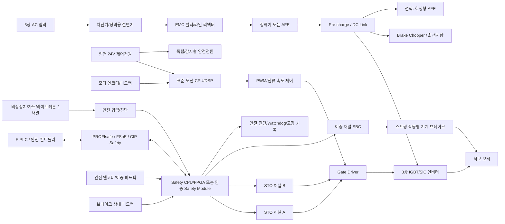
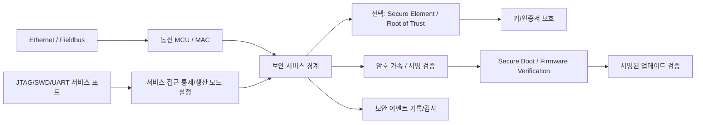

# SIL 3 서보 드라이브 하드웨어 블록 설계
**기준일:** 2026-11-17  
**설계 상태:** Reference Architecture v0.1 — 정격/부하/네트워크 미확정  
**목표:** IEC 61800-5-2 및 IEC 61508 기반 SIL 3 안전 서브기능을 구현할 수 있는 1축 서보 드라이브 하드웨어 기준 구조

## 1. 설계 원칙과 경계

1. **안전 경로와 일반 모션 경로를 분리한다.** 표준 모션 CPU의 오동작이 안전 차단 기능을 무력화하지 않도록 독립 safety CPU/FPGA 또는 인증된 safety module, 독립 watchdog/진단 및 이중 채널 차단 경로를 사용한다.
2. **SIL 3는 드라이브 부품 단독의 라벨이 아니다.** 센서, 안전 PLC, 안전 통신, 드라이브, 엔코더, 브레이크 및 기계적 위험저감 요소를 포함한 전체 안전 기능의 PFH/아키텍처/체계적 능력을 검증한다.
3. **STO는 전기적 절연이 아니다.** 토크 생성 에너지를 차단하지만 주전원 절연, 정비용 LOTO, 회전 관성의 즉시 정지 또는 수직축 하중 유지를 자동 보장하지 않는다.
4. **모션 안전 기능은 피드백에 의존한다.** SS2/SOS/SLS/SDI/SLP/SLI 등은 제품 인증 범위에 맞는 안전 엔코더 또는 이중 피드백과 진단을 사용한다.
5. **기계 브레이크는 별도 안전 요소다.** 수직축/중력 부하에는 fail-safe spring-applied brake, SBC, brake feedback 및 brake test를 고려한다.
6. **사이버보안과 기능안전의 추적성은 분리한다.** secure boot, signed update, credential/key storage, debug interface, access control 및 logging은 별도 cybersecurity requirement로 관리한다. 특정 TPM/secure element/JTAG 차단 기술을 CRA가 직접 지정한다고 표현하지 않는다.

## 2. 설계 가정 및 미확정 입력

| 항목 | 기준 구조 | 최종 확정에 필요한 값 |
|---|---|---|
| 축 구성 | 1축 단위, 다축/공유 DC bus 확장 가능 | 단축/다축, 축간 회생 공유 |
| 입력 | 3상 AC 입력 | 200/230/400/480 V, 50/60 Hz |
| 출력 | 3상 PWM 인버터 | 정격 kW, Arms, peak current, overload duty |
| 모터 | AC servo motor | rotary/linear/direct-drive, brake 유무 |
| 피드백 | safety-rated encoder 인터페이스 | 단일/이중 encoder, EnDat/Hiperface DSL/serial 등 |
| 안전 제어 | F-PLC + safety communication | PROFIsafe/FSoE/CIP Safety 중 하나 |
| 필수 안전 서브기능 | STO, SS1 우선; SS2/SOS/SLS/SDI/SBC/SBT는 위험평가 결과 | 각 기능별 SIL/PLr 및 reaction time |
| 설치 환경 | 산업용 제어반 | 온도, 고도, 오염도, 진동, EMC, IP |
| 회생 에너지 | DC bus + braking chopper/resistor 또는 regenerative supply | 부하 관성, 회생 빈도, 정지 횟수 |

이 문서는 파라미터화된 기준 구조다. 위 입력이 확정되기 전에는 회로도, PCB stack-up, 부품 번호, 열 설계, 단락 정격 및 PFH 최종 계산을 확정하지 않는다.

## 3. 전체 하드웨어 블록도

### 3.1 전력·모션·안전 경로

### 3.2 사이버보안 하드웨어 경계

**중요:** 보안 서비스 경계는 안전 CPU의 안전 실행 경로와 분리한다. 보안 업데이트, 네트워크 부하, 암호 연산이 safety task latency, watchdog, encoder sampling 및 PWM 제어 주기를 침해하지 않도록 자원/인터럽트/메모리 격리를 검증한다.

## 4. 하드웨어 서브시스템 설계

### 4.1 AC 입력·DC Link·전력 스테이지

- 입력 보호: MCCB/퓨즈, 정비용 disconnect, 서지/과전압 보호, 라인 리액터 및 EMC 필터.
- 정류: 출력/회생 요구에 따라 6-pulse diode bridge 또는 Active Front End(선택).
- Pre-charge: DC link capacitor 충전 제한, pre-charge relay/contactor, bypass 확인 및 실패 진단.
- DC link: DC bus capacitor, voltage sensing, discharge circuit, over/under-voltage protection, 온도/리플 검증.
- 인버터: 3상 2-level IGBT 또는 SiC MOSFET bridge, 상전류 측정, gate driver, desaturation/short-circuit 보호.
- 회생: braking chopper + resistor 또는 regenerative AFE. 회생 에너지/저항 온도/단선 진단은 별도 검토.
- STO는 gate pulse/torque-producing energy를 차단하는 안전 경로이며, DC link 방전이나 주전원 절연과 동일하지 않다. 정비용 disconnect/LOTO는 별도 유지한다.
- Power semiconductor 단락, gate driver stuck-on, common supply fault 및 cross-channel short를 포함한 FMEDA/고장주입 검증이 필요하다.

### 4.2 표준 모션 제어부

- Motion MCU/DSP: current loop, speed loop, position loop, trajectory, PWM generation.
- 전류 측정: phase current sensor(예: shunt/Hall/isolated amplifier), DC bus current/voltage.
- 피드백: 일반 모션용 encoder input은 safety-rated 여부를 별도로 확인한다. 일반 encoder 신호를 안전 피드백으로 자동 간주하지 않는다.
- 비안전 EtherCAT/PROFINET/EtherNet/IP 등 모션 통신은 safety protocol과 별도 connection/configuration을 유지한다.
- 표준 CPU가 hang되거나 PWM이 잘못되어도 safety module이 독립적으로 gate inhibit를 수행할 수 있어야 한다.

### 4.3 안전 제어부

- Safety CPU/FPGA 또는 제조사 인증 safety module: 독립 watchdog, clock monitoring, RAM/flash diagnostics, cross-comparison, safe-state output monitoring.
- 입력: dual-channel E-stop, guard switch, light curtain, enabling switch, external safe sensors. 단선/단락/교차단락 및 discrepancy time 진단.
- 안전 통신: F-PLC와 FSoE/CIP Safety/PROFIsafe 중 선택한 프로토콜의 certified endpoint 사용. Watchdog timeout, CRC, sequence, connection loss 시 정의된 safe reaction.
- STO: 독립된 A/B 채널로 gate driver의 안전 차단 입력을 제어한다. 각 채널의 고장 단독으로 토크 생성이 지속되지 않도록 certified circuit architecture와 diagnostics를 설계한다.
- 안전 파라미터: CRC/signature, 승인된 commissioning tool, write protection, version tracking, 안전 설정 변경 기록.
- Safety power: 모션/통신 전원과 안전 전원 간 단일 고장 영향, brownout, reset, ground fault 및 isolation을 분석한다.

### 4.4 안전 피드백 및 모션 모니터링

- STO만 필요한 기능과 SS2/SOS/SLS/SDI/SLP/SLI 등 motion monitoring 기능을 분리한다.
- 안전 기능 인증 범위에 맞는 safety encoder 또는 dual-feedback 구성 선택.
- Encoder fault: open/short, A/B channel mismatch, CRC/serial communication loss, overspeed, direction inversion, plausibility mismatch를 진단.
- 단일 encoder를 허용하는 인증 구성은 제조사 매뉴얼의 정확한 기능/카테고리/모터 조합을 그대로 따르고, 다른 제품에 일반화하지 않는다.
- Encoder cable routing, shield, connector, common-cause interference 및 vibration을 고려한다.

### 4.5 Safe Brake Control (SBC) 및 기계 브레이크

- 수직축/중력 부하에는 de-energize-to-apply spring brake 등 fail-safe brake를 우선 검토한다.
- Brake coil driver는 안전 요구에 맞는 이중 채널 또는 인증된 SBC 출력 사용.
- Brake feedback(접점, 상태 센서, brake travel/current/position) 및 brake test를 포함한다.
- 브레이크 체결/해제 순서와 지연은 SS1/SS2/STO sequence 및 기계 정지 거리로 검증한다.
- STO만으로 브레이크가 자동 체결되거나 중력 하중이 유지된다고 가정하지 않는다.
- 브레이크 전원은 I/O/제어 전원과 공유할 경우 단일 고장으로 안전 입력이 오동작하지 않는지 검증한다.

### 4.6 전원·열·EMC·기구

- Safety 24 VDC 및 logic 24 VDC를 분리하거나 인증된 절연/감시 구조를 사용한다.
- Gate driver, safety CPU, encoder receiver, DC bus 및 braking resistor의 열 경로를 별도 계산한다.
- IEC 61800-5-2 AMD1:2026의 EM/thermal/mechanical immunity 요구를 기준으로 시험 계획을 재작성한다.
- Encoder/safety input 케이블과 PWM/motor cable을 분리 배선하고, shield termination/grounding을 설계한다.
- Safety CPU/encoder interface의 EMC upset이 false safe/unsafe state, watchdog reset 또는 undetected dangerous failure로 이어지지 않도록 시험한다.
- PCB creepage/clearance, isolation barrier, protective earth, chassis bonding, thermal derating 및 vibration/shock는 최종 전압/환경 사양에 맞춰 계산한다.

## 5. 안전 서브기능별 구현 경로

| 안전 서브기능 | 드라이브 내 하드웨어/피드백 | 요구 검증 |
|---|---|---|
| STO | 이중 gate inhibit, 내부 진단 | A/B 단선·단락·교차단락, gate disable time, restart inhibit |
| SS1 | 모션 deceleration + safety timer/monitor + STO | decel ramp, timeout, 감속 실패 시 STO, 실제 stopping distance |
| SS2 | 감속 + 안전 속도/위치 모니터링 | encoder fault, standstill window, torque 유지 상태 |
| SOS | 안전 encoder/feedback + safe monitor | standstill deviation, encoder discrepancy, fault reaction |
| SLS | 안전 속도 추정/비교 + safe reaction | overspeed, threshold boundary, response time |
| SDI | 안전 방향 판단 | 역방향 진입, encoder direction mismatch |
| SLP/SLI | 안전 위치 피드백 및 limit monitoring | limit crossing, position reference loss, encoder failure |
| SBC/SBT | 이중 브레이크 출력, brake feedback | coil open/short, brake wear/stuck, brake test failure |
| SSM/SLA/SLT 등 | 제품별 certified safety monitor | 각 제조사 기능 범위와 sensor dependency를 따름 |

## 6. SIL 3 시스템 정량·아키텍처 검증

1. 고수요/연속 모드에서 SIL 3의 PFH 상한은 1×10⁻⁷/h 미만이다. 수치만으로 SIL 3를 주장할 수 없고 systematic capability, hardware architecture constraints, diagnostics, common-cause failure, software lifecycle 및 validation을 함께 충족해야 한다.
2. 안전 기능 체인의 PFH는 센서 + 안전 PLC + 안전 통신 + 드라이브 + 엔코더/피드백 + 브레이크/최종 요소의 실제 인증 범위에 맞춰 합산한다. 중복/공유 요소와 common-cause failure는 단순 합산만으로 처리하지 않는다.
3. Reference architecture는 HFT 1을 목표로 독립 이중 채널과 진단/교차감시를 우선 검토한다. 최종 HFT, SFF, DCavg, Category 및 subsystem type은 표준과 인증서에 따라 결정한다.
4. 각 안전 기능의 response time budget은 sensor detection + F-PLC scan + safety communication + drive safety task + gate disable + mechanical stop으로 분해한다.
5. Mission time, diagnostic test interval 및 maintenance interval은 최신 IEC 61800-5-2 AMD1:2026과 제조사 최신 문서에 따라 결정한다. 2016판 문서의 “proof test” 문구를 자동으로 최신 규격 요구로 적용하지 않는다.
**정기 점검 주의:** IEC 61800-5-2 AMD1:2026의 PDS(SR) proof-test 삭제가 기계 수준의 모든 정기 점검을 없애는 것은 아니다. IEC 62061 Ed.2.2 Clause 6.9 periodic testing, 제조사 diagnostic interval 및 기계 유지보수/validation 계획을 별도 적용한다.

## 7. 고장 반응 및 안전 상태 정의

| 고장/이벤트 | 기본 반응(위험평가로 확정) | 검증 포인트 |
|---|---|---|
| E-stop/guard open | SS1 또는 지정 정지 절차 후 STO | 정지거리, 체결 순서, restart inhibit |
| Safety comm timeout | 제품 인증에 맞는 safe reaction | watchdog timeout, fault detection time |
| Encoder loss/mismatch | 안전 모션 기능의 safe reaction; 필요 시 STO/SS1 | fault detection, speed/position plausibility |
| STO channel A/B fault | 다른 채널이 토크 차단을 유지하고 fault latch | single fault tolerance |
| Brake output/feedback fault | 수직축 낙하 위험에 맞춘 torque/stop strategy | brake engagement time, holding torque |
| DC bus overvoltage/undervoltage | 전력 보호 및 safety reaction 협조 | 회생/정지 중 과전압 |
| Safety CPU/watchdog/clock fault | 독립 gate inhibit, fault latch | common clock/power fault |
| Thermal/EMC upset | 안전 기능 유지 또는 검출된 safe state | immunity test, false acceptance 방지 |

## 8. 검증 및 시험 계획

- **설계/분석:** Hazard analysis, safety requirements specification, FMEA/FMEDA, PFH calculation, architecture constraint, CCF, systematic capability, safety software/parameterization review.
- **회로 단위:** STO 채널 open/short/cross-short, test pulse, gate driver fault, supply brownout, clock/watchdog, safe output stuck, brake coil open/short.
- **피드백:** encoder disconnect, short, CRC error, phase mismatch, overspeed, direction inversion, dual encoder disagreement, resolver/serial interface fault.
- **통신:** FSoE/CIP Safety/PROFIsafe connection loss, watchdog, CRC, sequence error, stale data, configuration mismatch, controller reset.
- **기능:** STO, SS1, SS2, SOS, SLS, SDI, SLP/SLI, SBC/SBT의 각 parameter boundary, response time 및 fault reaction.
- **시스템:** 실제 motor/load inertia, vertical axis, regenerative condition, brake delay, stop distance, restart prevention.
- **환경:** IEC 61800-5-2 AMD1:2026 기준의 EMC/thermal/mechanical immunity와 정격 전압/전류/온도 조건.
- **유효성 확인:** 독립 검토, 시험 기록, 소프트웨어/파라미터 버전, safety signature, 잔여 위험, 사용자 매뉴얼 및 maintenance/diagnostic interval 확인.

## 9. cybersecurity와 기능안전의 분리 추적

| 사이버보안 설계 항목 | 하드웨어/시스템 후보 | 기능안전 영향 검증 |
|---|---|---|
| Secure boot / signed firmware | ROM root of trust, crypto engine, optional secure element | 부팅 실패 시 safety outputs의 정의된 safe state |
| Key/credential storage | protected NVM/secure element/OTP | 안전 파라미터 key와 firmware key의 접근 분리 |
| Debug/service port | JTAG/SWD/UART access control, production lock | 서비스 모드에서 safety bypass 금지 |
| Network access control | secure gateway, VLAN/firewall, authenticated service | 네트워크 부하/DoS가 safety task timing을 침해하지 않음 |
| Security logging | security event storage, access/change audit | logging interrupt/flash wear가 safety timing에 영향 없음 |
| Update process | signed package, rollback protection, recovery image | 업데이트 중 safety outputs/parameter integrity 보장 |

이 항목들은 CRA의 위험기반 요구를 충족하기 위한 설계 후보이며, 특정 secure element/OTP/JTAG 방식이 CRA의 직접 의무라는 뜻은 아니다.

## 10. 주요 설계 위험 및 결정 대기

- 전원 정격/출력 범위 미확정: rectifier, DC link, IGBT/SiC, bus capacitor, braking resistor, thermal design을 결정할 수 없음.
- 안전 기능 범위 미확정: STO만으로 충분한지, SS1/SS2/SOS/SLS/SDI/SLP/SBC가 필요한지 위험평가 필요.
- 피드백 구조 미확정: SIL 3 motion monitoring의 encoder redundancy 및 motor compatibility가 달라짐.
- 네트워크 미확정: FSoE/CIP Safety/PROFIsafe 중 하나를 선택하고 F-PLC 생태계를 확정해야 함.
- 최신 표준 개정: 2026-10-30 IEC 61800-5-2 AMD1:2026에 대한 제조사 인증/문서 업데이트 여부 확인 필요.
- 제품별 PFH 범위 상이: 비교표의 PFH를 그대로 합산/순위화하지 않고 정확한 인증 범위와 safety function chain으로 재계산해야 함.

## 11. 참조

- IEC 61800-5-2:2016+AMD1:2026 CSV: https://webstore.iec.ch/en/publication/117563
- IEC 62061:2021+AMD1:2024+AMD2:2026 CSV: https://webstore.iec.ch/en/publication/112847
- ISO 13849-1:2023: https://www.iso.org/standard/73481.html
- IEC 61508-1:2026 PRV(최종 발행 예정 2027-01-22): https://webstore.iec.ch/en/publication/117296
- Mitsubishi MELSERVO-J5 safety sub-functions: https://www.mitsubishielectric.com/fa/products/drv/servo/pmerit/mr_j5/amp/safety_sub-functions.html
- Yaskawa Sigma-7 ASM7 product page: https://www.yaskawa.ie/motion-control/option-modules/productdetail/product/advanced-safety-module_15806
- Rockwell Kinetix 5700 safety reference manual: https://literature.rockwellautomation.com/idc/groups/literature/documents/rm/2198-rm001_-en-p.pdf
- Siemens S210 safety declaration: https://cache.industry.siemens.com/dl/files/250/109996250/att_1346004/v1/Safety_Manufacturers_Declaration_-_SINAMICS_S210_668.DCO.B2N.40.2509.029.pdf

**상태:** 기준 하드웨어 블록 구조는 작성 완료. 전기 정격, 모터/엔코더, 안전 기능 범위, 네트워크 및 열/EMC 조건 확정 후 회로도/BOM/PFH 계산을 상세화한다.
