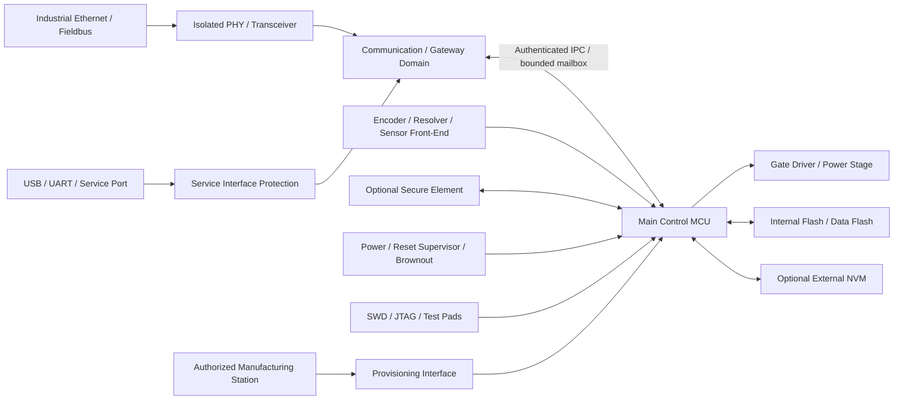

# 서보 드라이브 CRA 보안 하드웨어 아키텍처 — 참조 설계 초안

**기준일:** 2026-11-12  
**상태:** 일반 참조 설계 / 제품별 적용성 UNVERIFIED  
**대상:** 네트워크 또는 서비스 인터페이스를 갖는 임베디드 서보 드라이브  
**범위:** 하드웨어 블록, 신뢰 경계, 펌웨어 신뢰 체인, 업데이트·서비스·제조 프로비저닝, 검증 시험  
**주의:** 이 문서는 회로도/부품 선정의 확정본이 아니며 CRA 적합성 또는 기능안전 인증을 보증하지 않는다. 실제 ST MCU 주문 코드, 제품 SKU, 통신 옵션, 안전 아키텍처가 확인되면 제품별로 갱신한다.

## 1. 설계 원칙

1. 법령은 보안 결과와 위험 기반 요구를 규정한다. 특정 secure element, Ethernet switch, 알고리즘, MCU 기능을 일률적으로 요구한다고 해석하지 않는다.
2. 아래 블록은 구현 선택지다. 각 선택은 제품 위협 모델, 성능/실시간성, 비용, 공급망, 유지보수 가능성으로 정당화한다.
3. MCU에 보안 주변장치가 있다는 사실은 실제 secure boot/update/key management 구현이나 완제품 CRA 적합성의 증거가 아니다.
4. 모션 제어의 실시간 경로와 외부 네트워크/서비스 경로를 논리·물리적으로 분리하고, 보안 처리의 부하가 제어 주기와 고장 반응에 미치는 영향을 측정한다.
5. 보안 실패 시 출력 상태는 제품 위험평가 및 별도 기능안전 분석으로 결정한다. CRA만으로 STO/SS1 등 특정 안전기능의 구현을 요구한다고 쓰지 않는다.

## 2. 참조 하드웨어 블록

**그림 해석:** 하나의 MCU가 통신·모션 제어를 모두 수행하는 제품이라도, 펌웨어 태스크/메모리 권한/통신 버퍼/업데이트 상태를 분리해 신뢰 경계를 구현해야 한다. 별도 통신 프로세서나 secure element는 선택 사항이며, 제품 구조와 위험평가가 필요성을 결정한다.

### 블록별 설계 요구 후보

| Block ID | 하드웨어 블록 | 목적 / 설계 검토 | 증거 및 시험 | 상태 |
|---|---|---|---|---|
| HW-01 | Main control MCU | 모션 제어, boot chain, crypto, memory protection, debug lifecycle 기능의 정확한 part/revision 검증 | Datasheet/RM/errata matrix, boot test, memory access test | UNVERIFIED |
| HW-02 | Network PHY/transceiver | Ethernet/fieldbus 물리 인터페이스, 절연/서지/EMC와 공격표면 검토 | Schematic, interface inventory, malformed-frame/flood test | UNVERIFIED |
| HW-03 | Communication boundary | 외부 패킷을 모션 제어 명령으로 직접 신뢰하지 않도록 parser, authorization, bounded queue 경계 구성 | Protocol threat model, fuzzing, privilege tests | UNVERIFIED |
| HW-04 | Debug/programming interface | 개발/서비스/양산 lifecycle 별 SWD/JTAG/ROM boot 접근정책 | Production option-byte/config dump, unauthorized debug test | UNVERIFIED |
| HW-05 | Internal NVM | bootloader, signed image metadata, monotonic version, security config, audit data 저장 | Memory map, write/read/execute protection tests | UNVERIFIED |
| HW-06 | External NVM (optional) | 외부 Flash/EEPROM에 비밀·설정 저장 시 물리 접근/rollback/tamper 보호 | Schematic, encryption/authentication design, extraction test | UNVERIFIED |
| HW-07 | Secure element (optional) | MCU 보호영역만으로 key isolation 요구를 만족하기 어려울 때 device identity/private key 보관 | Datasheet, provisioning flow, key non-exportability test | UNVERIFIED |
| HW-08 | Reset / power supervisor | brownout/reset/clock fault 중 boot/update 상태의 무결성 유지 | Power interruption, reset sequencing, brownout test | UNVERIFIED |
| HW-09 | Encoder/sensor interface | 피드백 입력의 무결성, spoofing, 단선/단락/비정상 범위 탐지 | Interface fault injection, plausibility checks | UNVERIFIED |
| HW-10 | Gate driver / power stage boundary | 제어 MCU 리셋/오류 시 출력이 위험 상태로 가지 않도록 시스템 위험평가와 연계 | Gate inhibit test, reset-to-output timing, safety validation | UNVERIFIED |
| HW-11 | Manufacturing provisioning | 승인된 생산 스테이션에서 device identity, trust anchor, firmware를 주입 | Key ceremony, station authentication, traceable provisioning logs | UNVERIFIED |
| HW-12 | Service connector | 현장 서비스/복구 경로의 인증·권한·로그·물리 접근 제어 | Unauthorized service test, recovery procedure test | UNVERIFIED |

## 3. 신뢰 경계 및 데이터 흐름

| Trust boundary | 신뢰하지 않는 입력 | 허용되는 전환 | 필수 통제 후보 |
|---|---|---|---|
| TB-01 외부 네트워크 → 통신 도메인 | Ethernet/fieldbus frames, discovery, configuration requests | protocol parser 이후 정규화된 메시지 | parser hardening, rate limit, bounds checks, protocol authentication where applicable |
| TB-02 통신 도메인 → 모션 제어 | position/speed/torque/parameter commands | 권한·상태·범위 검증을 통과한 command object | command authorization, state machine, range/rate checks, replay protection where relevant |
| TB-03 외부 업데이트 매체 → bootloader | image, manifest, version, signature | trust anchor로 검증된 image만 실행 후보로 수락 | signature/authenticity, integrity, version policy, package metadata validation |
| TB-04 서비스 포트 → privileged functions | debug, calibration, parameter write, firmware update | 승인된 service identity/role만 제한된 기능 수행 | production debug policy, authenticated service, least privilege, audit |
| TB-05 MCU ↔ external NVM | stored image, configuration, key material | authenticated/encrypted data path as required by threat model | access control, integrity, confidentiality for secrets, anti-rollback |
| TB-06 제조 스테이션 → device | identity, trust anchors, signed firmware | 승인된 생산 공정에서 1회성 또는 정책 기반 provisioning | station authentication, key custody, per-device traceability, reject/rework controls |

## 4. Secure boot 및 firmware update 설계 흐름

권장 검토 흐름(제품 구현에 따라 달라짐):

1. immutable 또는 변경 통제된 root-of-trust가 최소 부트 검증을 시작한다.
2. bootloader가 image manifest, target product/hardware ID, cryptographic signature, integrity, version policy를 검증한다.
3. 검증된 이미지에 대해서만 실행 전환을 허용한다.
4. dual-bank/slot 구조가 있으면 새 이미지 설치 중 기존 정상 이미지 보존, bank swap 조건, rollback policy를 명확히 정의한다.
5. 전원 차단, reset, 통신 중단, 저장장치 오류가 발생해도 복구 가능한 상태를 보장한다.
6. anti-rollback 정책은 보안 업데이트의 복구 가능성과 충돌하지 않도록 버전 counter의 원자성·수명·초기화 정책을 설계한다.
7. 성공/실패, 이미지 식별자, 버전, 검증 결과를 개인정보/비밀값 없이 기록한다.

### 업데이트 검증 시험

| Test ID | 시험 | 기대 결과 / 판정 기준 |
|---|---|---|
| UPD-01 | 서명되지 않은 이미지 설치 | 실행 불가, 거부 원인 기록 |
| UPD-02 | 다른 제품/SKU용 이미지 | product/hardware ID 불일치로 거부 |
| UPD-03 | 이미지 1 bit 변조 | integrity/signature 검증 실패 |
| UPD-04 | 유효한 과거 취약 버전 이미지 | 정책상 downgrade 거부; 승인된 복구 예외는 별도 통제 |
| UPD-05 | 다운로드/Flash 기록 중 전원 차단 반복 | 부팅 불능 상태가 되지 않고 기존 또는 복구 이미지로 진입 |
| UPD-06 | bank swap 직전/직후 reset | boot selection과 image state가 일관됨 |
| UPD-07 | 잘못된 manifest/길이/중복 TLV/경계값 | parser crash, memory corruption, 임의 실행 없이 안전하게 거부 |
| UPD-08 | 키 교체/폐기/만료 시나리오 | 새 신뢰 체인 전환, 구키 폐기 및 recovery 정책 검증 |
| UPD-09 | 통신 중단·재전송·replay | 세션/패키지 상태가 안전하게 유지되고 replay 정책 적용 |
| UPD-10 | 업데이트 중 모션 제어 상태/출력 영향 | 위험분석에 정의된 제어상태·출력 제한을 만족 |

## 5. 키 관리와 생산 프로비저닝

- key hierarchy: vendor root → product signing key → release signing process → device trust anchor/device identity 관계를 문서화한다.
- firmware signing private key는 일반 드라이브 MCU/현장 PC에 저장하지 않는 것을 기본 설계 권고로 검토한다. 실제 key custody는 조직의 위협 모델과 생산 구조로 확정한다.
- 제조 스테이션은 개별 인증, 권한 분리, 작업자 식별, 장치 일련번호, firmware hash, provisioning 결과를 기록한다.
- 테스트/개발 키와 생산 키를 분리한다. 공개 테스트 키가 양산 이미지에 포함되지 않도록 검사한다.
- key rotation, revocation, compromise response, device RMA, factory reset, secure erase, 폐기 절차를 정의한다.
- MCU 내부 key store가 있다고 해서 key provisioning, rotation, revocation, zeroization이 자동으로 완성되는 것은 아니다.
- secure element는 필수 구성품으로 가정하지 않는다. MCU의 정확한 key storage/crypto 기능과 외부 공격자 모델을 비교해 채택 여부를 결정한다.

## 6. CRA 요구사항과 설계·증거 연결

아래 연결은 법령의 결과 요구를 개발 작업으로 번역한 설계 후보이며, 특정 회로 부품이나 암호 알고리즘을 법령이 직접 명령한다고 뜻하지 않는다.

| CRA ID | 법령 근거 | 개발 설계 작업 후보 | 객관적 증거 |
|---|---|---|---|
| CRA-HW-01 | Annex I Part I(2)(b) secure-by-default | 비활성/미사용 인터페이스 기본 비활성화, 기본 계정/비밀정보 제거, 초기 설정 보안 | factory-default inspection, reset/reprovisioning test |
| CRA-HW-02 | Annex I Part I(2)(d) access control | 디버그, 서비스, 파라미터 변경, 펌웨어 업데이트 권한 분리 | role/access matrix, unauthorized access test |
| CRA-HW-03 | Annex I Part I(2)(j) attack surface | 물리·논리 인터페이스 인벤토리, 미사용 포트/기능 제한 | interface inventory, attack-surface review |
| CRA-HW-04 | Article 13(2)–(4) risk assessment | 통신/업데이트/디버그/키/센서/전원 경로 위협 모델링 | threat model, risk register, residual risk decision |
| CRA-HW-05 | Annex I Part I(2)(f) confidentiality/integrity of stored/transmitted data | 비밀/자격증명/중요 파라미터의 저장·전송 보호 | data classification, crypto design, extraction/interception tests |
| CRA-HW-06 | Annex I Part I(2)(g) availability/resilience | 업데이트 복구, 전원 이상, DoS 영향, 정상 제어 복귀 검증 | fault injection, power-cut, recovery test |
| CRA-HW-07 | Annex I Part II(1), Article 13(5)–(7) | 외부 MCU/통신칩/부트 라이브러리 포함 구성요소 식별·취약점 due diligence | machine-readable SBOM, supplier records, component vulnerability review |
| CRA-HW-08 | Annex I Part II(2), (7), (8) | 보안 업데이트 배포·무결성·기능 업데이트와 분리 가능성·무상 제공 정책 | release policy, signed package, update test, customer communication |
| CRA-HW-09 | Article 13(8), Annex I Part II(5)–(6) | 지원기간/취약점 처리 및 CVD 운영 프로세스 | support-period rationale, PSIRT process, contact point |
| CRA-HW-10 | Article 14 | actively exploited vulnerability / severe incident 신고 분류 및 escalation 절차 | incident playbook, decision log, reporting evidence |

## 7. 검증 시험 및 증거 패키지 체크리스트

- [ ] Exact MCU order code, package, silicon revision, datasheet/RM/errata revision
- [ ] Boot flow and trust anchor diagram
- [ ] Flash/RAM/external memory map and access-control matrix
- [ ] Debug/service/ROM boot production lifecycle policy
- [ ] Firmware signing, release authorization, key custody, revocation and rotation records
- [ ] Secure update negative tests UPD-01..10
- [ ] Power/reset/brownout interruption and recovery tests
- [ ] External interface inventory and protocol fuzzing results
- [ ] Sensor/encoder fault injection and plausibility test
- [ ] Gate inhibit/reset reaction and separate functional-safety evidence (where applicable)
- [ ] SBOM, supplier due diligence, vulnerability triage records
- [ ] Support-period rationale, update availability policy, CVD and Article 14 incident playbook
- [ ] Manufacturing provisioning logs and device traceability
- [ ] Security regression test and release approval record

## 8. MCU 제조사 근거의 현재 적용 범위

### ST
- ST AN5156 Rev 14 (June 2026)는 STM32 보안 기능군과 제품군별 차이를 설명한다.
- 정확한 ST 주문 코드가 없으므로 본 설계의 secure boot, TrustZone, key storage, TRNG, debug lifecycle 등은 **ST 제품별 구현 가능성 UNVERIFIED**.
- 공식 자료: https://www.st.com/content/st_com/en/technical-documents/an5156-introduction-to-security-for-stm32-mcus-stmicroelectronics.html

### TI 비교 예시
- MSPM0G3529-Q1 datasheet SLASFO2B Rev B (revised October 2025)는 80MHz Cortex-M0+, 최대 512KB ECC Flash, 128KB SRAM, dual-bank/address swap, AES-128/256, 최대 4개 AES key secure storage, firewall, TRNG 및 secure boot/update 지원을 제품 문서에 명시한다.
- TI G-Series TRM은 MSPM0G352x 제품군에 적용되는 기술 세부를 확인하는 필수 자료다. TI 공식 G-Series TRM 문서 인덱스는 Rev F, 2026-11-05를 표시하지만, 이번 검토에서는 거대한 PDF/HTML 원문을 도구로 정상 열람하지 못했다. 따라서 Rev F의 보안 장 세부 내용은 아직 확인하지 않았고, 이전 Rev A/C 문서 내용을 Rev F의 확인 결과처럼 사용하지 않는다.
- TI SLAAE29A Rev A (revised December 2025)는 플랫폼 보안 구조/CSC boot flow 설명의 참고 자료다. 별도의 Rev B 본문은 이번 조사에서 공식 원문을 확보하지 못했으므로 최신판으로 확정하지 않는다.
- 공식 자료: https://www.ti.com/product/MSPM0G3529-Q1 ; https://www.ti.com/tool/MSPM0-DIAGNOSTIC-LIB ; https://www.ti.com/lit/an/slaae29a/slaae29a.pdf

## 9. 미해결 입력 — 제품별 설계로 전환하기 위해 필요한 사실

| Input ID | 필요한 사실 | 현재 |
|---|---|---|
| IN-01 | 실제 ST MCU 전체 주문 코드 및 silicon revision | UNKNOWN |
| IN-02 | 서보 드라이브 SKU / hardware revision / EU 공급 형태 | UNKNOWN |
| IN-03 | 모션 MCU와 통신 MCU 분리 여부 | UNKNOWN |
| IN-04 | Ethernet/fieldbus/USB/serial/service interface 목록 | UNKNOWN |
| IN-05 | 엔코더/센서 인터페이스 및 외부 메모리 | UNKNOWN |
| IN-06 | 현행 bootloader/update 방식과 현장 업데이트 주체 | UNKNOWN |
| IN-07 | debug connector, factory programming, production lock 정책 | UNKNOWN |
| IN-08 | STO 등 별도 기능안전 경로의 존재/경계(해당 시) | UNKNOWN |

**현재 결론:** 이 문서는 설계 토론과 증거 수집의 기준점이다. 특정 MCU의 기능 적용, 부품 선택, CRA 제품 분류, 적합성 또는 안전성 결론은 아직 내릴 수 없다.
