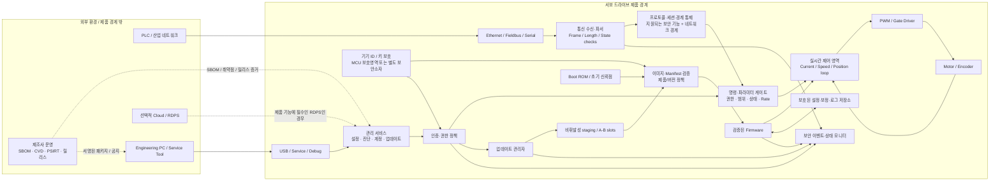

# CRA 산업용 서보 드라이브 참조 보안 아키텍처

- 문서 버전: v0.2 (일반 참조 설계 / 설계 검토 반영 / 특정 제품 구현 전)
- 기준일: 2026-11-18
- 활성 범위: CRA 사이버보안 요구사항
- 관련 문서:
  - [CRA 통합 규제·기술 준수 보고서 v0.2](CRA_INTEGRATED_COMPLIANCE_REPORT_2026-11-17.md)
  - [35개 CRA 요구사항 추적표](CRA_REQUIREMENTS_TRACEABILITY_2026-11-17.csv)
  - [15개 인터페이스 적용성 매트릭스](CRA_SERVO_DRIVE_INTERFACE_APPLICABILITY_2026-11-17.csv)
  - [36개 보안 통제·시험 매트릭스](CRA_SERVO_DRIVE_SECURITY_CONTROL_TEST_MATRIX_2026-11-17.csv)

## 1. 목적과 설계 원칙

본 문서는 네트워크/디지털 인터페이스가 있는 산업용 서보 드라이브의 CRA 대응을 위한 **논리적 참조 보안 아키텍처**다. 실제 회로도, MCU/SoC 모델, 메모리 구성, fieldbus stack, 업데이트 경로가 제공되지 않았으므로 특정 하드웨어 설계의 승인 또는 구현 완료를 의미하지 않는다.

설계 원칙:
1. 실시간 모터 제어 경로와 외부 통신/관리 경로를 논리적으로 분리한다.
2. 부팅·펌웨어 업데이트·설정 변경·서비스 접근의 신뢰 경계를 명확히 한다.
3. 제품 위험평가 결과에 따라 보안 통제를 선택하고, 각 통제에 시험 방법과 증거를 연결한다.
4. CRA가 요구하는 보안 결과와 특정 기술 구현(MFA, RBAC, secure element, digital signature, encryption 등)을 구분한다. 기술은 위험·성능·비용·수명주기 검토 후 선택한다.
5. STO/SS1, 안전 토크 차단, 브레이크 동작 등 기능안전 동작을 CRA의 자동 요구사항으로 가정하지 않는다. 별도 hazard analysis와 해당 안전 법령/표준의 적용성으로 결정한다.
6. 기본 구성은 현장 산업 네트워크, PLC/상위 제어기, 엔지니어링 PC, USB/serial service, 선택적 cloud/RDPS를 포함할 수 있으나, 실제 제품에 존재하는 경로만 적용한다.

## 2. 논리 블록 구조

### 2.1 블록별 책임

| 블록 | 보안 책임 | CRA 연결 | 설계/검증 상태 |
|---|---|---|---|
| Ethernet/Fieldbus | 외부 데이터 진입점, 프로토콜·포트 최소화 | Annex I Part I (2)(d),(f),(h),(i),(j) | 제품별 인터페이스 확인 전 |
| Service/Debug | 생산·현장 서비스 접근 통제 | Annex I Part I (2)(d),(j) | 실제 포트/모드 확인 전 |
| Communication/Management | 입력 검증, 명령 권한, rate/resource limit | Annex I Part I (2)(d),(f),(h),(j),(k) | protocol stack 미확인 |
| Boot ROM/Bootloader | 부팅 신뢰 시작점, 복구/업데이트 경계 | Annex I Part I (2)(a),(b),(f); Part II (2),(7) | MCU 기능 확인 전 |
| Firmware Verification | 이미지 무결성·버전·호환성 확인 | Annex I Part I (2)(a),(f); Part II (2),(7) | 구현 후보 |
| Control MCU/SoC | 실시간 제어와 관리 코드 간 영향 제한 | Annex I Part I (2)(h),(i),(j),(k) | SoC/RTOS 미확인 |
| NVM | 설정·로그·업데이트 슬롯의 기밀성/무결성/삭제 | Annex I Part I (2)(e),(f),(l),(m) | 메모리 구성 미확인 |
| Key/Identity | 기기 식별·키 보호·인증 | Annex I Part I (2)(d),(e),(f) | secure element는 선택 후보 |
| Watchdog/Health | 장애 탐지 및 핵심 기능 복구 | Annex I Part I (2)(h),(k) | 성능/안전 영향 검증 필요 |
| Manufacturer operations | SBOM·CVD·패치·지원기간·신고 | Annex I Part II (1)-(8), Articles 13-16 | 프로세스/증거 작성 필요 |

## 3. 신뢰 경계 및 데이터 흐름

### TB-1: PLC/산업 네트워크 ↔ 드라이브 통신부
- 데이터: cyclic command/status, parameter access, diagnostics, firmware/service messages.
- 주요 위험: 무단 파라미터 변경, 악성/비정상 프레임, DoS, protocol parser 취약점, 다른 노드에 대한 네트워크 영향.
- 후보 통제: allowlist, command range checking, access control, rate/resource limit, unused service disable, network segmentation.
- 시험: valid/invalid frame, malformed packet fuzzing, unauthorized write, replay/sequence, flood/resource exhaustion, recovery.

### TB-2: Engineering PC/Service Tool ↔ 드라이브
- 데이터: commissioning, tuning, firmware update, diagnostic log, configuration import/export.
- 주요 위험: 악성 PC/도구, 권한 상승, 설정 파일 변조, 서비스 포트 오남용, 공용 자격증명.
- 후보 통제: tool identity, authenticated session, role-based function separation, signed configuration/update, production debug lock, service-mode timeout.
- 시험: unauthorized tool, expired credential, modified config, service-mode exit, debug unlock attempt, interrupted update.

### TB-3: Boot chain ↔ firmware image
- 데이터: bootloader, firmware image, version metadata, signature/hash, update manifest.
- 주요 위험: 악성 firmware, downgrade, corrupted image, update interruption, wrong model image.
- 후보 통제: hardware/ROM root of trust, signed image verification, version policy, dual-bank/recovery, model compatibility checks. 실제 필요성/방법은 MCU·제품 위험평가에 따라 결정.
- 시험: invalid signature, modified image, downgrade, wrong model, power loss during update, recovery from corrupted slot.

### TB-4: Firmware ↔ non-volatile storage
- 데이터: user configuration, credentials/keys, logs, calibration, update metadata.
- 주요 위험: 설정/키 추출, log tampering, corrupted configuration, data remnants after decommissioning.
- 후보 통제: protected storage, integrity checks, access control, secure erase/cryptographic erase where suitable, log retention policy.
- 시험: unauthorized read/write, corruption, rollback, factory reset, recovery and data remanence checks.

### TB-5: Drive ↔ optional cloud/RDPS
- 데이터: remote diagnostics, fleet management, telemetry, remote update, identity/token.
- 주요 위험: cloud account compromise, tenant crossover, API abuse, third-party service outage, remote command misuse.
- 판단: 원격 처리가 제품의 기능 수행에 필수이고 제조자가 개발했거나 책임지는 경우 RDPS 제품 경계에 포함될 수 있다. 단순 독립 SaaS는 자동 포함되지 않는다.
- 후보 통제: tenant isolation, scoped API tokens, strong authentication, access logging, secure transport, least privilege, service separation.
- 시험: tenant isolation, token revoke, unauthorized remote command, cloud outage, data export, third-party compromise tabletop.
- cloud가 실제 제품에 없다면 해당 경계는 N/A로 문서화한다.

### TB-6: 제조사 공급망/개발·릴리스 환경
- 데이터: source code, third-party dependencies, build artifacts, SBOM, signing keys, release package.
- 주요 위험: compromised dependency, build pipeline compromise, signing key theft, incorrect SBOM, untracked release.
- 후보 통제: dependency pinning, SBOM, reproducible/protected build, signing key separation, release approval, vulnerability intake.
- 시험: dependency compromise simulation, signature key access review, SBOM-to-build reconciliation, release provenance review.

## 4. 보안 통제 설계 선택지

### 4.1 하드웨어/부트 영역
- MCU/SoC가 제공하는 secure boot, immutable boot ROM, debug lock, memory protection, hardware cryptographic acceleration, secure key storage 기능을 비교한다.
- Secure element/TPM을 추가할지, MCU 내 protected storage로 충분한지 비용·공급·수명주기·복구·인증 위험을 비교한다.
- OTA/USB/serial 업데이트를 지원하는 경우 부트 체인과 복구 경로를 함께 설계한다.
- watchdog, brown-out, power-loss recovery가 업데이트·로그·설정 저장에 미치는 영향을 검증한다.
- 하드웨어 기능이 부족하더라도 위험평가상 동등한 보호 통제를 구현할 수 있는지 검토한다.

### 4.2 펌웨어/소프트웨어 영역
- 안전한 기본 구성, 불필요 서비스 제거, 명령/파라미터 범위 검증, 입력 길이/형식 검증을 구현 후보로 둔다.
- 통신 stack, bootloader, RTOS, cryptographic library, diagnostic library 등 구성요소의 SBOM과 취약점 대응을 관리한다.
- 업데이트는 모델/하드웨어 revision/firmware version을 검증하고, 변조·downgrade·중단 상황을 시험한다.
- 보안 로그에는 접근·설정·업데이트·권한 변경 등 제품 위험에 필요한 이벤트만 기록하고, 저장공간·개인정보·사용자 opt-out 요구를 고려한다.
- 실시간 control loop의 지연·jitter·CPU/memory budget에 미치는 보안 통제 영향을 측정한다.

### 4.3 통신/관리 영역
- 제품에 존재하는 인터페이스만 목록화하고, 각 프로토콜의 읽기/쓰기/관리 명령을 구분한다.
- 안전한 원격 관리 채널과 실시간 필드버스 경로를 분리할 수 있는지 검토한다. 모든 실시간 프로토콜에 무조건 암호화를 추가한다고 가정하지 않는다.
- 진단/설정 포트는 기본 비활성화 또는 제한된 서비스 모드 등 위험기반 정책을 검토한다.
- 외부 명령의 인증·권한·범위·빈도·상태 전이 검증을 수행한다.
- 네트워크 오류가 드라이브뿐 아니라 PLC·다른 노드에 미치는 영향을 검증한다.

## 5. 보안 요구사항·시험 매트릭스 연결

각 통제는 기존 문서와 다음 방식으로 연결한다.
- 법적 요구사항: [35개 CRA 요구사항 추적표](CRA_REQUIREMENTS_TRACEABILITY_2026-11-17.csv)
- 인터페이스 분류: [15개 인터페이스 적용성 매트릭스](CRA_SERVO_DRIVE_INTERFACE_APPLICABILITY_2026-11-17.csv)
- 통제/시험 후보: [36개 보안 통제·시험 매트릭스](CRA_SERVO_DRIVE_SECURITY_CONTROL_TEST_MATRIX_2026-11-17.csv)

권장 검증 단계:
1. 각 SEC ID에 해당 제품 인터페이스/블록/펌웨어 모듈을 연결한다.
2. 적용되지 않는 통제는 제품 기능·데이터 흐름·위험평가 근거로 N/A 처리한다.
3. 적용 통제는 설계 산출물·시험 케이스·시험 결과·결함/시정조치 ID로 추적한다.
4. 미실시 시험은 '미검증', 증거가 없는 통제는 '증거 미확인' 상태로 유지한다.
5. 제품 변경/펌웨어 릴리스/표준 개정 시 영향 분석과 재시험 범위를 결정한다.

## 6. 제품별 확정에 필요한 자료

1. MCU/SoC 정확한 부품 번호와 silicon revision, 보안 기능 reference manual.
2. Boot ROM, bootloader, secure boot, debug lock, key storage 지원 여부.
3. Flash/RAM/EEPROM/secure storage 구성과 update slot/rollback 설계.
4. Ethernet/fieldbus/CAN/serial/USB/wireless 인터페이스와 protocol stack 버전.
5. Firmware architecture, RTOS, task/interrupt/resource budget, real-time control loop.
6. Parameter map, command set, authentication/authorization 기능.
7. PC commissioning tool, cloud/RDPS, remote access 경로 및 공급 주체.
8. Secure update package, signing key lifecycle, recovery procedure.
9. SBOM, vulnerability handling/CVD, support period, security update release process.
10. Machinery/기타 EU 법령 인증서가 있다면 해당 인증서의 제품·위험 범위.

## 8. v0.2 설계 검토 — 데이터 경로와 관리 경로 분리

기존 도식의 `COMM → AUTH → FW` 연결은 실시간 cyclic command, 특권 설정 변경, 펌웨어 업데이트를 같은 처리 흐름으로 오해할 수 있어 위 도식에서 구분했다.

- **실시간 데이터 경로**: Ethernet/fieldbus/serial 수신 → 길이·형식·상태 검증 → 프로토콜/세션 및 네트워크 경계 통제(지원되는 범위) → 명령/파라미터 게이트 → 실시간 제어 루프.
- **관리 경로**: engineering/service/cloud(제품에 실제 존재하는 경우) → 관리 서비스 → 인증·권한 정책 → 설정/진단/업데이트 기능.
- **부팅·업데이트 경로**: 제조사 릴리스 패키지 → staging → manifest·서명·제품모델·버전 검증 → boot chain 재검증 → 실행. 실제 부트 ROM/보호 키 기능은 선택 MCU의 reference manual과 silicon revision으로 확인한다.
- **감사·관찰 경로**: 통신·인증·업데이트·설정·보안 상태 이벤트를 제품 위험에 필요한 범위로 기록하되, 저장공간 고갈·로그 변조·민감정보 과수집을 함께 시험한다.

중요한 제한: 모든 필드버스 cyclic frame마다 별도 사용자 인증이나 암호화를 강제하는 설계를 가정하지 않는다. 프로토콜이 제공하는 인증/보안 기능, 네트워크 분할, 관리 명령의 권한통제, 제품 위험평가를 함께 검토한다. 실시간 루프에 비결정적 네트워크/암호화 작업을 직접 배치하지 않는다.

## 9. 단일 MCU와 분리형 제어 구조 선택 기준

| 구조 후보 | 장점 | 위험/검증 부담 | 채택 판단 기준 |
|---|---|---|---|
| 단일 MCU + 하드웨어/RTOS 격리 | BOM·전력·통신 지연·개발 복잡도 절감 가능 | 공유 CPU/RAM/DMA/interrupt/flash가 공격·오류 영향을 전파할 수 있음 | MPU/privilege, 메모리·DMA 경계, watchdog, 자원 예산, 실시간 WCET/jitter 측정으로 격리 목표를 입증할 수 있을 때 |
| 통신/관리 MCU + 실시간 제어 MCU 분리 | 외부 입력 처리와 제어 루프의 장애·공격 영역을 구조적으로 분리 가능 | BOM·전력·보드 공간·공급망·펌웨어 이중화 및 inter-processor protocol 검증 비용 증가 | 외부 노출·복잡한 프로토콜·원격관리·실시간 영향 위험이 단일 MCU 격리로 충분히 낮아지지 않을 때 |
| 별도 보안 소자 추가 | 기기 identity/키 저장 및 특정 암호 작업을 분리할 수 있음 | 공급/수명주기/프로비저닝/복구·인증서 관리 복잡성 | MCU 내 보호영역으로 키 수명주기와 공격자 모델을 충족하지 못한다는 근거가 있을 때 |

**선택 원칙:** 이 표는 특정 MCU나 보안소자 채택 권고가 아니라 설계 의사결정 기준이다. CRA가 dual-MCU, secure element, TPM, 특정 암호 알고리즘을 일률적으로 요구한다고 해석하지 않는다. ST/TI 등 부품 비교는 정확한 part number, silicon revision, 보안 기능 reference manual, errata, 수명주기/공급 자료를 확보한 뒤 수행한다.

## 10. 핵심 설계 통제와 수용 기준

| 영역 | 설계 후보 및 수용 기준 | 최소 검증 시나리오 | 연결 추적 |
|---|---|---|---|
| 입력·프로토콜 | length/format/state validation, parser bounds, 명령별 read/write 분류, 지원하지 않는 기능·포트 비활성화 | malformed/truncated/oversized frame, fuzz, replay/sequence, parser crash, protocol downgrade | EVD-03/06/07; SEC-009/010/011/032 |
| 특권 명령·파라미터 | 관리 write는 인증·권한·범위·운전상태 검증을 통과. cyclic setpoint는 프로토콜/네트워크 경계와 실시간 수용 정책을 별도 정의 | 무권한 parameter write, 경계값, 상태전이 위반, flood, 계정 만료/취소 | EVD-05/06/07; SEC-005/007/009/012 |
| 부팅 신뢰 | boot chain 각 단계에서 다음 단계의 진위·무결성 확인; root key 보호와 key rotation/revocation 계획; 복구 이미지도 동일 검증 | 변조 이미지, 잘못된 모델 이미지, 손상된 manifest, 키 만료/취소, 전원 차단 | EVD-08; SEC-007/021 |
| 업데이트·복구 | 제품/하드웨어 revision/버전/의존성 확인, 안전한 staging, 원자적 전환, 복구 가능성, 지원기간 내 업데이트 제공; anti-rollback은 복구 불능을 만들지 않도록 정책화 | 서명 오류, downgrade, 중간 전원 차단, 저장공간 부족, 구버전 복구, A/B slot 손상 | EVD-08/11; SEC-004/021/024 |
| 디버그·서비스 | 양산 모드에서 불필요 debug 경로 잠금/비활성화; 서비스 개방은 승인·시간 제한·감사 가능하도록 위험기반 설계 | SWD/JTAG/UART unlock, 공용 credential, 서비스 종료 후 재잠금, 물리 접근 가정 | EVD-03/05; SEC-003/005/011 |
| 키·기기 ID | 제조 시 고유 ID/키 프로비저닝, 제조·서비스·폐기 단계의 접근 통제, 비밀정보 로그/백업 유출 방지 | 키 추출/복제, 초기화, 교체, 취소, 생산라인 권한 및 폐기 절차 | EVD-03/05/06; SEC-005/006/007 |
| 실시간 격리 | security processing이 control loop의 deadline/jitter/CPU budget을 침해하지 않음; 오류 시 명시적 bounded behaviour 정의 | worst-case packet load, interrupt storm, DMA contention, task starvation, CPU/RAM/flash exhaustion | EVD-02/03/07; SEC-009/010/012 |
| 로깅·삭제 | 접근·설정·업데이트·보안 이벤트를 최소 수집, 보호·용량관리, 사용자 opt-out 해당 여부 검토, 안전한 삭제 | 로그 변조/삭제, clock skew, storage full, 개인정보/credential 누출, factory reset | EVD-03/14; SEC-013/014 |
| 공급망·빌드 | 릴리스 버전과 SBOM/소스/빌드 산출물 연결, third-party component due diligence, signing key separation | SBOM-to-image reconciliation, 취약 dependency, build compromise, 서명키 접근 감사 | EVD-09/10/16; SEC-015/016/030 |

수용 기준은 법령 문언을 대체하지 않는다. 법적 목표는 CRA 조항 및 Annex I의 제품 위험/특성에 따라 판정하고, 위 기술 항목은 이를 입증하기 위한 위험기반 구현·검증 후보로 관리한다.

## 11. 업데이트·부팅 검증 순서

1. 제조사 release pipeline에서 제품 모델, HW revision, firmware version, dependency/SBOM, build provenance를 하나의 release identity로 묶는다.
2. update manifest에 대상 제품·버전·필요한 전제조건·패키지 digest를 포함하고, 신뢰된 서명 검증을 수행한다. 구체 암호 알고리즘과 키 길이는 부품 지원·위협모델·표준/정책에 따라 결정한다.
3. 장치에서 패키지 진위·무결성·대상 모델·버전 정책을 검증한 후 비활성 slot 또는 안전한 staging에 기록한다.
4. 부팅 시 ROM/bootloader가 다음 단계의 무결성을 검증하고, 실패 시 승인된 recovery path만 실행한다.
5. 성공 부팅·자가진단·버전 확인 뒤 active slot을 확정하고, 실패/전원 차단 시 일관된 복구 상태를 검증한다.
6. 보안 업데이트 제공 이력과 사용자 안내, 각 업데이트의 장기 이용 가능 기간을 별도 관리한다(Article 13(9) 기준).

## 12. 제품별 설계 확정에 필요한 추가 입력

현재 참조 설계의 미확정 항목은 다음과 같다. 자료가 없으므로 임의로 부품·기능을 가정하지 않는다.

- MCU/SoC 정확한 part number, silicon revision, security feature/errata, lifecycle status.
- single/dual MCU 여부, CPU/MPU/RTOS/task/interrupt/DMA/memory partitioning.
- boot ROM, secure boot, debug lifecycle, key storage/provisioning 지원.
- flash topology, update slot, recovery image, power-loss behaviour, rollback/anti-rollback policy.
- fieldbus/ethernet/serial/USB/wireless 실제 포트, 프로토콜/stack 버전 및 명령 권한 구조.
- engineering tool, remote service, cloud/RDPS의 intended purpose, 계약/책임 주체 및 기능 필수성.
- parameter map, safety-related boundary, real-time WCET/jitter/CPU/RAM budget.
- 제조/서비스 key lifecycle, SBOM, PSIRT/CVD, support period, update archive 운영 증거.

## 13. v0.2 검토 상태 및 다음 단계

- 문서 수준: 참조 아키텍처의 경로 구분과 설계 수용 기준을 구체화했다.
- 제품 수준: 미검증. 실제 회로/부품/펌웨어/프로토콜/시장 공급 증거가 없어 특정 설계의 적합성·보안성·실시간성·기능안전성을 승인하지 않는다.
- 시험 수준: 미실시. 위 시나리오는 시험 계획 후보이며 pass/fail 결과가 아니다.
- 다음: 제품 자료 intake 이후 block-to-component mapping, MCU 후보 비교(ST/TI), real-time resource budget, update boot chain, interface threat model을 실제 제품 variant별로 작성한다.

## 7. 제한사항 및 다음 단계

- 이 문서는 제품별 회로도/펌웨어를 분석하지 않은 참조 아키텍처다.
- 특정 MCU/secure element/암호 알고리즘/필드버스 보안 기능을 CRA가 직접 의무화한다고 주장하지 않는다.
- 실제 기능안전 동작, STO/SS1, 브레이크/모터 토크 차단의 설계는 별도 안전 분석과 승인 절차를 따른다.
- 다음 단계는 제품별 자료를 확보해 블록 경계와 SEC ID를 실제 부품/펌웨어/시험 증거에 연결하는 것이다.
